# Friendly Friend Helper - First Term Project by Jannis Volz
## Online Deployment

I have deployed my app using Heroku, which you can find here: http://friendlyfriendhelper.herokuapp.com/    

Unfortunately I need to start with two disclaimers:

- The server is not able to handle two clients at once right now. It will break the sequence of portrayed images, which causes the entire application to be out of sync. I decided, that the effort needed to implement client-handling were out of scope for my prototype. Please just keep this in mind if you want to try out the application simultaneously, it won't work unfortunately. 
- Google Chrome has access to additional voices when using WebSpeech API, which are of much better quality than the standard voices. For other browsers I had to resort to one of the default voices. If you want the true experience, consider using Chrome to use my App.  

## Initial Idea

Originally, I wanted to do a project about depression. I wanted to raise awareness by giving people an insight on how depression is correlated to certain socio-demographic factors, as well as that it does have a variety of symptoms, apart from "feeling sad". For that I wanted to do some data analysis on the distribution of depression and its dominating symptoms, related to socio-demographic factor like income, age and history of immigration. I wanted to use a StyleGAN to synthesize pictures of non-existing people representing certain clusters of increased prevalence of depression. This should give the huge, anonymous mass-survey data a face, to make it more accessible.  

## First Mentoring Meeting

I got the feedback, that the project was to large for the scope of a first term project. This made me think. Portraying people of certain ages, genders or ethnicities and having them serve as archetypes for depression is a very sensitive topic in two ways: Mental illness AND group identity.  
Not being able to convey the message of the project precisely might therefore cause more harm than good. Regarding thee feedback, that my project was to large, I doubted that I could handle this sensitive topic with the necessary care.  
Additionally, in my first presentation in P&R, I received feedback, that I should work on my creative skills.  
I decided to change my topic to something less sensitive, and to something that would allow to express my personality some more.
During the meeting, I got the idea to somewhat flip my idea on its head. Instead of generating pictures of people and have them represent depression, I thought of generating pictures of people and have another AI detect the emotions in the people, exhibiting the results.

Stefan recommended me a video on CLIP, a Neural Network that can categorize images into any sets of given categories, without the need to have trained it on these specific categories first.

 

## Session 01 - Exploration

I Watched the video about the CLIP paper.

This shifted my interest in doing an interactive application, that showcases – and makes fun of – some bizarre classifications an AI makes. This felt to me like a more authentic way of expressing myself, which is through humor.  
Two of my favorite movies are Being John Malkovich by Charlie Kaufman and Spike Jonze, as well as The Lobster by Giorgos Lanthimos. Both movies create bizarre worlds, in which deeper philosophic topics are explored through humor.  
This is a way of presenting a certain topic, that I am interested to apply to interactive media art.

I had the idea to associate this state-of-the art algorithm with something as ordinary as speaking childrens toys like the one in the following Family Guy scene:

 

## Session 02 - Exploration
I read the CLIP paper again:

[Multimodal Neurons in Artificial Neural Networks](https://openai.com/blog/multimodal-neurons/#fallaciesofabstraction)  

I installed CLIP on my device and tried to test it on some images. I quickly realized, that a single image as an input would not work and that I had to input a set of possible labels, too.
At this point I was still trying to understand where the labels like "Standard poodle" or "piggy bank" *come from*.  

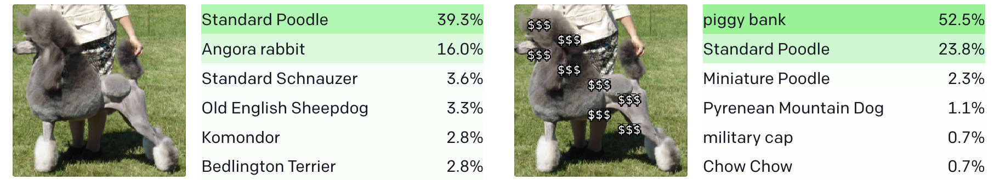  

I only knew of neural networks that where pre-trained on a given set of labels, which would then simply output the estimated labels with just an image as the input. So at that point I thought I had to train CLIP on my desired set of labels, which seemed like to demanding a task.  
I then learned, that CLIP can handle any set of possible labels without any additional training, as it was trained with the entire power of GPT-3, which impressed me a lot.

## Session 03 - Exploration

I downloaded a set of 1000 pictures from NVidia StyleGAN generated faces dataset.

[GitHub - NVlabs/stylegan: StyleGAN - Official TensorFlow Implementation](https://github.com/NVlabs/stylegan)

  

As CLIP prefers entire sentences as labels, I searched for a dataset of describing sentences of people. This was a little hard to do, as some just covered a small number of very basic emotions like “happy”, “sad”, while others were too specific like “A man with a white shirt and colourful shorts surfing on a wave”.  
I finally found a fitting dataset of 132 descriptions of people.  
Making CLIP actually usable was very painful for me, as I had not developed in Python for quite some time. It took me a lot of time to understand, that I needed to install a python virtual environment in order for imports of installed conda modules to work.

I tried out CLIP with the labels and it had a weird, strong bias towards selecting certain fringe labels like "sardonic". I figured GPT-3 was not well trained on those, and I removed those labels.

## Session 04 - Exploration

I ran all the images from the StyleGan dataset, only to find out there is a StyleGan2 dataset with higher quality images.

[https://github.com/NVlabs/stylegan2](https://github.com/NVlabs/stylegan2)

I looked at the outputs and curated about 250 of the 1000 photos, which I found to have produced interesting or funny outputs. the *AI* classified a relatively big chunk of people as being "awful", "terrible" and the like. This made me realize, that I could create a narrative out of this.

## Session 05 - Narrative 
I did research about procedural narratives:

[What's the difference between Procedural Narrative and Emergent Narrative?](https://www.edmcrae.com/article/whats-the-difference-between-procedural-narrative-and-emergent-narrative)
  
I decided I wanted to create a simple procedural narrative by loading random images based on if they are negative and positive, thus creating an experience that is equal in the overall narrative every time, but always different in the details.  
I manually grouped the images based on if the classification was negative or positive. Within these groups, I grouped the images by “levels of intensity”, meaning a classification like "pragmatic" is less intense, than "wonderful".

 I am still thinking about how to actually present the *AI* outputs, so people will understand, that it is how the *AI* classifies the images.

I also think about the general structure of the app. Ideas:

- images just be shown and an audio output is given what this person is considered to be
- people be able to select the images and put them into the *AI* themselves?
- a kind of a “rail-shooter” were you have to click the faces while your automatically passing by
- a game show were you have to classify the faces and the *AI* will tell you the answer afterwards

In any case, I think about how to get a narrative structure into the application, without maaking everything too complicated. Maybe 3 Act structure? How to intensify during the Acts? Maybe just get faster?

[Visualizing "Interactive Data Visualization" with the Three Act Structure](https://medium.com/@cheesybrooke/visualizing-interactive-data-visualization-with-the-three-act-structure-6fab8467fa35)

## Session 06 - Narrative

I stumbled upon this article, in which an AI talks about if an AI can be ethical:

[Can Artificial Intelligence Be Ethical? This AI Has Some Thoughts](https://sea.ign.com/news/180421/can-artificial-intelligence-be-ethical-this-ai-has-some-thoughts)

It says, that AI is a tool like any other tool, and it can be used for good or bad. It continues to elaborate however, that cybernetic implants for humans containing conscious AI would be the future, proving to me that it would not be a very good tool to use.

I got the idea of a bad – as in – bizarre application of AI use in a very personal realm where it is not needed. This should create a juxtaposition in which users would ask themselves, if AI is a actually a good tool in such personal matters.   
I came up with an interactive web-site through which to acquire synthetic friends. the *AI* will guide you and assess each potential friends. 

As an end I could imagine the whole view disintegrating with a data moshing aesthetic.

## Session 07 - Narrative

Reflected further on the presentation of the application.

I thought of Tinder-like cards of the people, were you can either decide to become friends or not become friends, but I am unsure, because I don’t want the application to be too referential specifically to Tinder. I decided to do it that way anyway, as users would understand the interaction metaphor (*what to actually do*) more easily this way.

## Session 08 - Datastructure

I am thinking about the data structure I want to use to preprocess the curated images and store them in a database for faster loading:

id : int → filename without png  
tone: string → negative/positive  
intensity: string → 1, 2, 3, funny  
img: image file  
classification: string → the actual classification  
certainty: float → certainty of the classification  

I change my python script to process all the images and then put them into a MongoDB hosted on Atlas.

## Session 09 - Decision: MERN Stack

I did some research regarding which framework(s) to use for my website. I decided on doing a MERN Stack, primarily as I wanted to learn how to do it, as it is very common in the industry. Secondarily I think using React will later benefit me in doing Animations in the Interface.

## Implementation: MERN Stack Session 10

I am having problems with the MongoDB Atlas. It for some reason does not display any of my data, even though it says, that there are the correct number of entries in the DB. I learn, that putting the images directly into the DB as raw binary causes it to be extremely slow due to document size.  
So I change my python script again, this time setting up a GridFS filesystem on Atlas and only storing the keys in the DB.  
I had a lot of problems retrieving the image binary data from GridFS in node.js and sending it on to the route. This was because the GridFS functions in node.js are not defined as asynchronous, but they act asynchronously, always resulting in unfished data being sent to the route. I learned, that the GridFS Downstream Object has predefined listeners however, which I could use to only send the response on the end of the datastream.

I also had a lot of problems displaying the sent image in the front end. I tried extremely long to fetch the binary data with a webhook, converting it to a blob and then setting the img src to the blob url. After many hours I finally realized, i can just set the img src directly to the binary image route “localhost/3001/image”.

Then I had to re-setup the database and all my python imports don’t work again, as I moved the python script inbetween.

As I use a random document from the database, and I send information from it as a response on different ports, the image route “localhost/3001/image” always lagged behind the classification route "localhost/3001/classification". I fixed that by retrieving the first image and classification results from the DB on application load. When requesting the classification route in the client, I then send the old classification result, while also triggering the retrieval of the next result. This way the image had some time to load.

## Session 11 - Speech Synthesis
I had some troubles setting up the speech synthesis. At first, it loaded in the next image and content before the speech synthesis had finished describing the current one. I wrapped the speech api in a promise and changed it to an async function, this way the new content only loads in after the speech has finished.

Also added a class server-side that lets me set a fixed sequence of classes of images to load, making it easier to implement a narrative.

I am then proceeding to add conditional speech synthesis, that changes depending if a user “makes the wrong or right choice”.

## Session 12 - Three Act Structure

### What do I want to achieve?

I want to create a situation, in which a viewer is equally fascinated and disturbed by how AI is able to classify people but also how it fails to do so. I want people to reflect on their blind trust in AI, but I don’t want to slander AI.

I briefly considered not doing a three act structure, but instead using Dan Harmons Story Circle

[How Dan Harmon's Story Circle Can Make Your Story Better](https://www.studiobinder.com/blog/dan-harmon-story-circle/)

I committed to this three act structure template however:

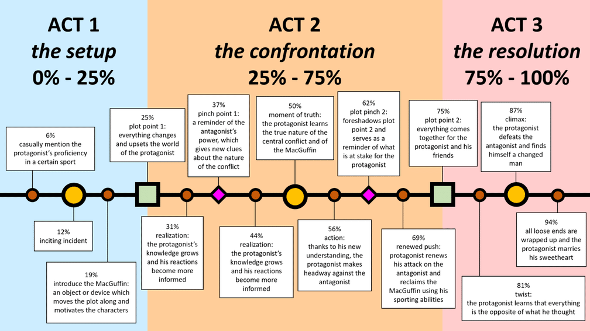

I developed the first draft of my narrative, defining discrete steps. When researching ways to somewhat easily implement this rough "Step-Layout", I discovered the library react-step-wizard. This was a nice fit, significantly easing the process of creating sequential steps, which I can easily switch around to test things without everything becoming chaotic.:
### **Act I**

#### **Hook + Antagonist Introduction (Start Point)**

the *AI* introduces itself and explains what it does.

#### **Inciting Incident (Step 1)**

Making your first choice, who to befriend or not. (Positive Image)

#### **Step 2**

A Positive Image.

#### **Step 3**

A funny image. Makes Step 1+2 the setup for a joke.

#### **Step 4 + 5**

A positive image.

### **Act II**

#### **Plot Point 1 (Step 6)**

An Image is presented which turns out to be classified extremely negatively.

#### **Step 7 + 8**

A positive image

#### **Pinch Point 1 (Step 9)**

Negative image. The friendly friend helper comments on the decision you just made.

#### **Step 10 + 11**

A positive image.

#### **Moment of Truth (Step 12)**

Negative image. The friendly friend helper informs you, that your selection so far has been worrying, and that you might endanger yourself if you continue with this behaviour.

#### **Step 13 + 14**

A positive image.

#### **Pinch Point 2 (Step 15)**

Negative image category 3. The friendly friend helper intercepts and decides over your head, that you will not befriend this person.

#### **Step 16 + 17**

A negative image. categories 1-2.

### **Act III**

#### **Plot Point 2 (Step 18)**

Negative image. The friendly friend helper again takes control away from you, this time not returning it. It informs you, that you will not befriend this person.

#### **Twist Step 19**

Only negative images. The friendly friend helper dismisses all of them immediately.

#### **Climax (Step 20)**

A button to exit the application is now presented. 

#### **Step 21**

A page is loaded, where everything is handled as if nothing happened and everything is normal. 

“Liked our friendly friend helper? We can also recommend:” Then proceed to display other real or fake applications where AI is already integrated in very personal spaces.  

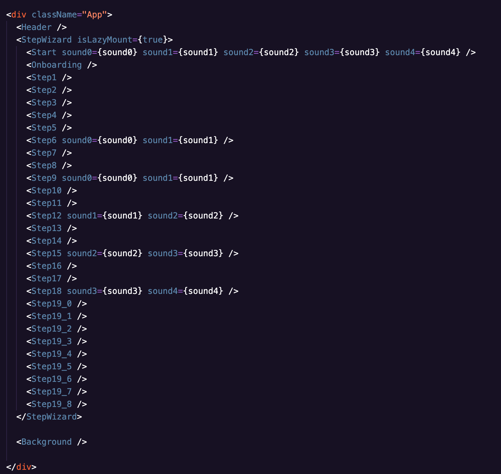

[*From here on, when writing "Step" with a capital letter, I am referencing a StepWizard Step.*]

## Session 13 - GUI

I am starting to design the GUI and have searched for ways to make it look innocent. I decided to use [Crayola](https://www.1001fonts.com/crayola-font.html), a crayon-like font for the header:  

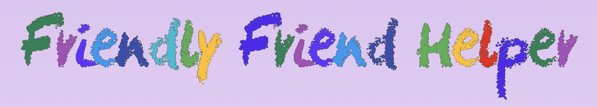

I then looked for free, equally innocent icons for the [Friend](https://flyclipart.com/friend-interface-male-icon-with-png-and-vector-format-for-free-friends-icon-png-796177#) / [Not Friend](https://www.shutterstock.com/image-vector/opponent-rival-competitor-paragon-challenger-enemy-2000820080) buttons. Later I manually traced them with a brush in GIMP to make them fit the crayon style, as well as drawing a circle around them to make them more easily identifiable as buttons.

| ||
|-|-|
| ||

I proceeded to design the Interface for selecting a friend in Figma:
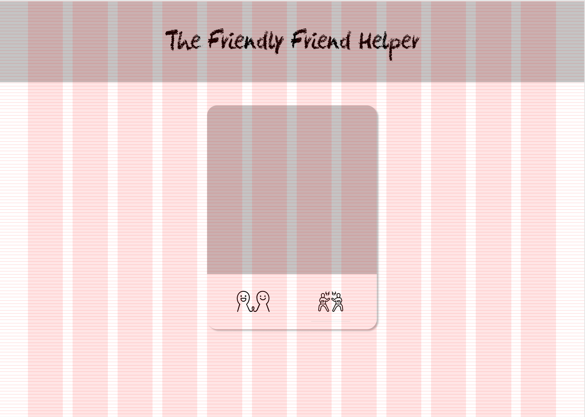

## Session 14 - GUI + Some Backend Smoothing
In Act III, where the *AI* fully takes control away from you, I wanted to communicate this loss of user control by changing the color of the buttons to grey. For first testing I had just copied the entire code from one Step to the other, which would now catch up with me. I would have had to change all Steps manually. So I decided to refactor instead. I outsourced what is rendered in each step two two components:
One where the buttons are active and one where they are not active. This way i seperated the logic from the UI in the front-end, while also making future adjustments far easier.

I also added a rainbow effect to the header, which supported the innocent child-like look.

I then wanted to implement, that no duplicates are shown during one run of the entire experience.  Server-side, I excluded by filename. This caused some troubles because of my own implementation of picking random images from a certain subset, for which I have to pre-process the MongoDb Query Object using db.query(). This had slightly different Syntax for the parameters than the much more well-documented db.find(), which made it hard to find the right way to exclude the previous files using nin. After some trial and error I found the right way to set the query.

## Session 15 - GUI Pictures + Voice Selections
At that point my page looked like that:
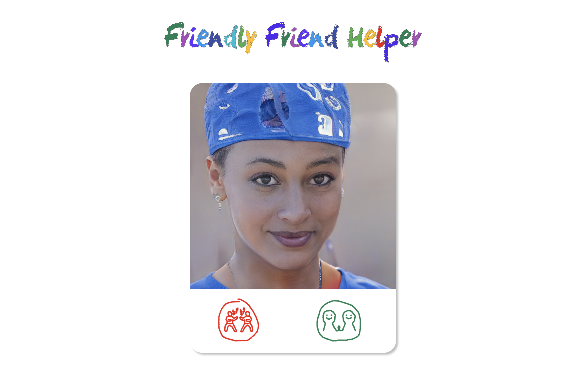

I found it looked very empty, especially at the sides, so I looked online for some free [pencil or crayon drawings](https://www.pinterest.com/pin/601723200202795302/). I used an online tool to automatically remove the background, which left me at this:
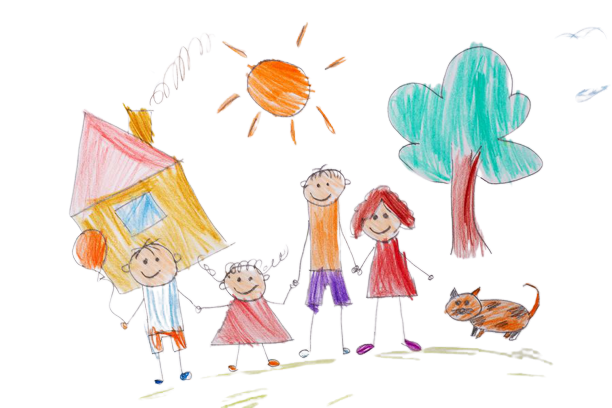

I cut out the sun and people in GIMP and added them to my page:

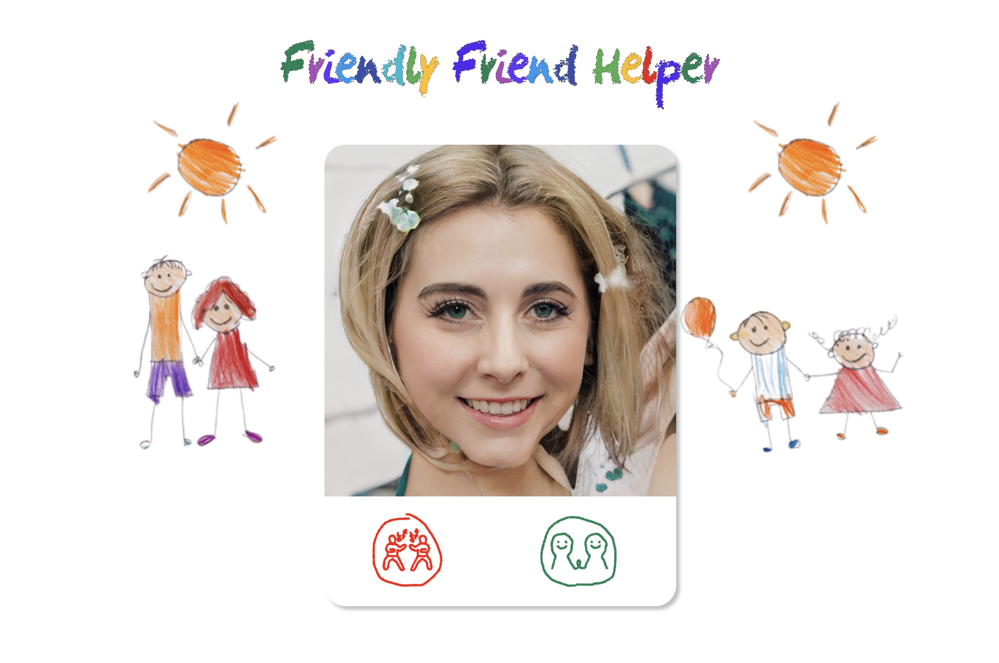

I additionally made website responsive, with two different layouts for mobile and desktop.

I then tried out the available voices in the SpeechSynthesis API and decided on ‘Google US English’ because of her great warm tone, which creates a nice juxtaposition to the dark content she says.

## Session 16 - Modularization + Server Changes

I had to change some functionalities in the Steps again, which I had copy-pasted before. So I modularized the functions in the client to reduce redundancies and make future changes more efficient.

I then researched the possibilities to change one of the most time-consuming aspects of my implementation so far, fetching the image from the db on the server and sending it to the image route. I contemplated this, because the images where rather large at ~1.4mb, causing them to be loaded quite slowly in the front-end, which conflicted with the rhythm of the application. So I thought about scaling and compressing the images in the backend. After a discussion with Stefan, we came to the conclusion that this had no priority.

I also did some research on if I should implement handling of multiple clients on the server. Right now I think, there would be issues if two people use the app at the same time. I deprioritized that, too, though.

## Session 17 - GUI Updates + SpeechSynthesis Horror Session 17

I did some more updates on the responsiveness of the page and added a background gradient, to make the GUI less sterile (Smartphone version): 

I then proceeded to set up the greeting Step for Hook + Antagonist Introduction. I had tested the App on a friend, who did not fully unterstand what the buttons represented, so I also added an explanation here.  
|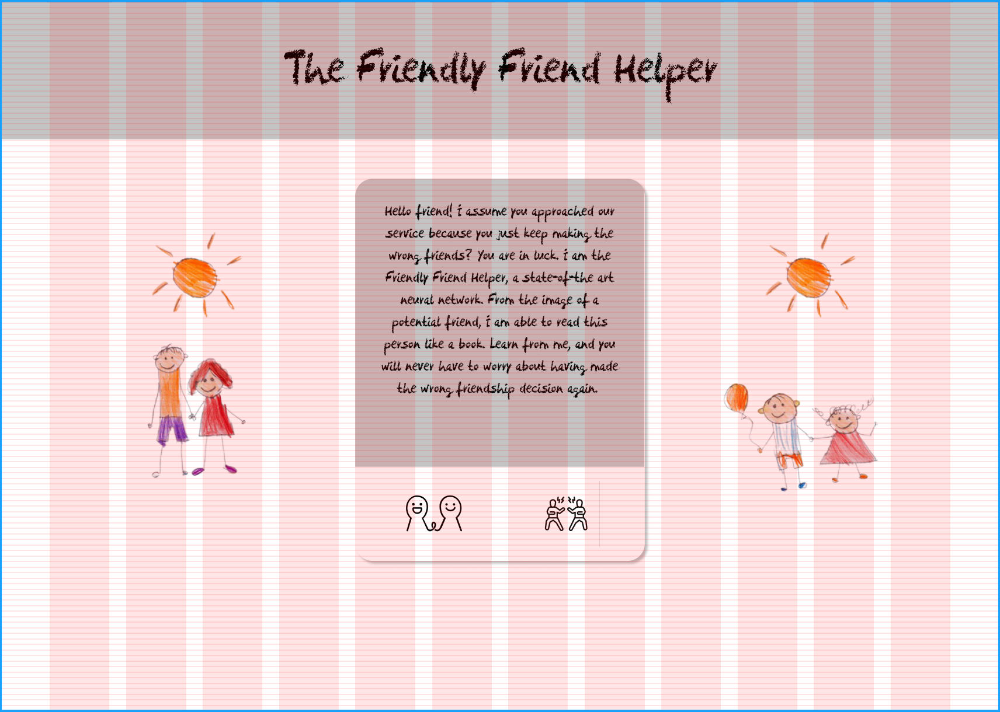 |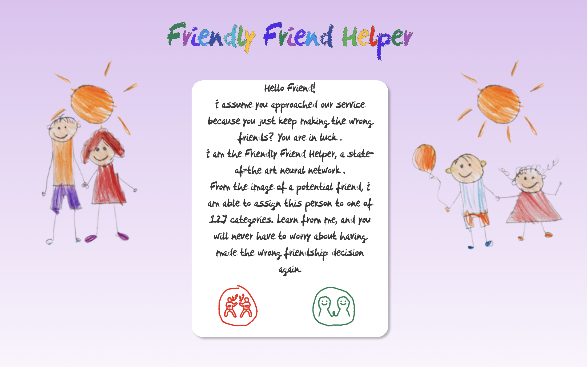|
|-|-|
| Figma | CSS|

 In this Step the greeting message should be read out via speech synthesis, too (with the interaction explanation only read out by speech synthesis, without being written down, while also being supported with fitting animations on which button is currently referenced in the explanation). This was a kafkaesquely frustrating experience. At first it just did not work. After a lot of unnecessary debugging I found out, that browsers block audio from being played, when there has not been an interaction before that. So I put the Greeting screen as the second step instead of the first, so an interaction in step 1 preceeds it. Then it worked. One time. After which (I had not made any changes) the speech synthesis stopped working completely. Also after interacting with a friend/notfriend button, which had worked every time from the first implementation until now.
It turned out, that if you play a speech synthesis message in Chrome, that is longer than 15 seconds, Speech Synthesis API crashes and [stops working until you restart the browser](https://bugs.chromium.org/p/chromium/issues/detail?id=679437).

## Session 18 - Start and Ending

Playing sound automatically is supressed by browsers, which is why I added a start screen before the greeting to the application. This is benefitial anyway, so I can tell users to turn on their sound. I designed the screen, audio works now.  
|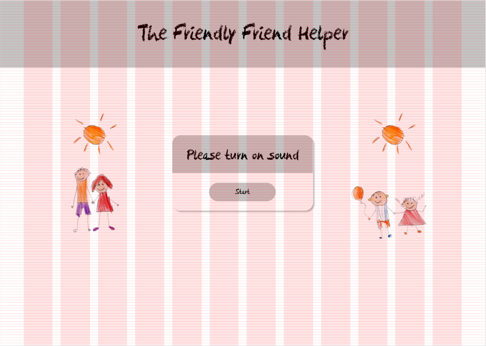 |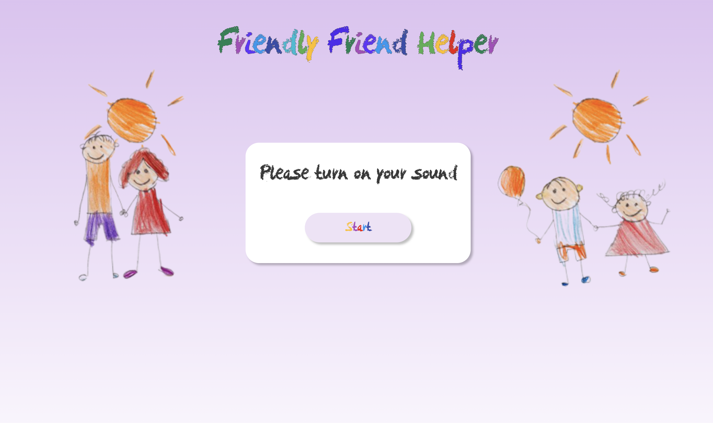|
|-|-|
| Figma | CSS|

I added an ending overlay, which is supposed to be somewhat separated from the Friendly Friend Helper in terms of style, indicating that Friendly Friend Helper has ended and this is information coming from the overarching organization, that Friendly Friend Helper is a part of. By slowly fading the overlay in, I wanted to convey the idea, that the organization system tries to casually distract from the fact, that the *AI* is a little out-of-control. Designing the overlay itself was quite challenging, making it fade in even more so. But with some stackoverflow and trial and error I solved it in the CSS.
The overlay should contain 4 examples of AI being used in absurdly intimate situations, suggesting the same organization created these and, which should lead users to associate them with each other. I aimed for users to therefore extend their critical reflection of AI use beyond just Friendly Friend Helper.  

 I wanted to take some real world examples, while also adding a few made-up ones. The problem was, that even the most outrageous examples I could make up, were revealed through a quick Google search to already exist in some way. So I linked to these existing services instead. The examples I chose were:
 - [Alexa (Homely Home Helper)](https://developer.amazon.com/en-US/alexa)
 - [Muse (Optimizey Child-Optimization Helper)](https://www.socoslearning.com/), an AI-heavy app which gives you tips on how to parent your child in a way, that the child will optimally develop desired traits.
 - [Sarah (Anxious Anxiety Helper)](https://www.sarahthetherapist.org/), an AI psychotherapy app aiming to replace human psychotherapy.
 - [Slutbot (Sexy Sex Helper)](https://www.juiceboxit.com/), an AI chatbot with whom you can "Dirty Talk" and that is "a safe space to master your sexting skills"
 
|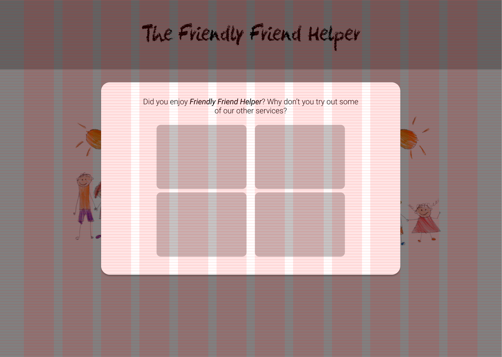 |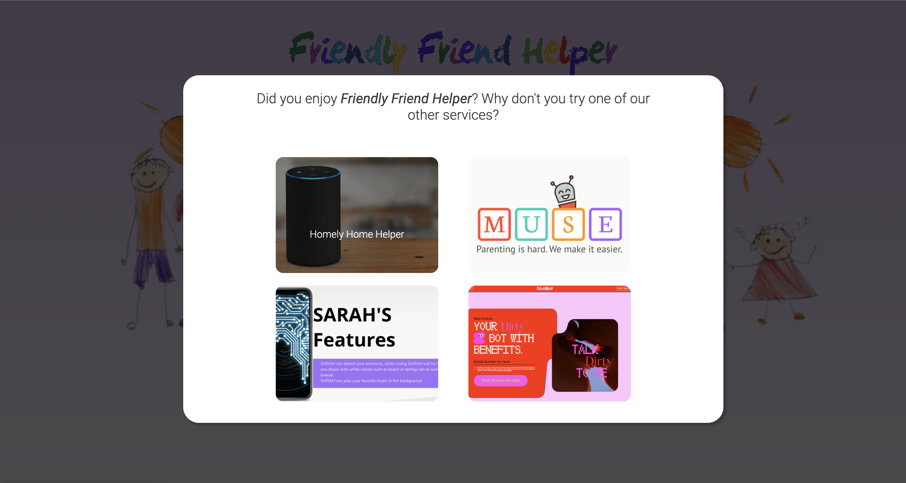|
|-|-|
| Figma | CSS|

To arrange the images in Figma, I used a "Layout" object for the first time (in Figma). This was a huge revelation to me, as this seemed to be the technique to easily create responsive components, that I was looking for all along. Converting the Figma CSS output to a functioning CSS was great simplified through this.

## Session 19 - Music

With an ongoing writer’s block concerning adding additional monologue for the *AI* / making the experience longer, I decided to add sound to the experience. My first approaches in Arturia Pigments in Ableton without any samples turned out to be way to etheral and not fitting the experience at all. The experience would need a happy percussive-heavy loop, which would take quite long to do from scratch-

I then looked online for ukulele loops, as i thought that those would fit the experience quite well. [I found one](https://www.noiiz.com/sounds/samples/204226)

I then loaded it into ableton, added a background pad and worked with warp markers and frequency shift to create 5 versions of the soundtrack. The ukulele sample gets increasingly frequency shifted and warped, aiming an eerie tone reminiscent of a wobbly vinyl.

## Session 20 - Music Implementation + CSS Fun

I stumbled upon the problem, that I needed to create a sound object, and play it. As i use react step wizard, I had to find a way to access the sound later on, as I needed to fade to the next, more eerie version at some point.

I selected the library Howler.js

My problem was, that I thought i needed an ID, which I receive from the player once I play the media. I could not play the files from load, as browsers suppress audio without previous use interaction. I could not retrieve the ID from the inner Step Component, if I started the sound there, because of scope.

In the end I found out, that the documentation was just not that precisely written, and I did not need the ID afterall, but could just change the Howl object directly.

After that I edited my final step (The recommendation of other services), to also be responsive to mobile users, which was a hassle.

## Session 21 - CSS Polishing + More Text Session 21

I made some more changes to the CSS for the start Step of the handheld version, which I previously forgot to make fully responsive.

I got the feedback, that it would benefit my app to have some more AI monologue. To implement this, I thought of centralizing this in a class called FlavorGenerator (Not making the same mistake of copy-pasting everything over every Step, again.). The Generator is activated from Step 9, which is when the *AI* begins to comment on your decisions. I added roughly 8 text snippets for each of these 4 situations: 
1. The portrayed image is positive, the user wants to be friends.
2. The portrayed image is negative, the user wants to be friends.
3. The portrayed image is positive, the user doesn't want to be friends.
4. The portrayed image is negative, the user doesn't want to be friends.  

The snippets are then selected randomly. I wrote these snippets in a way that should foreshadow the continuing shift of the *AI*s focus from *Finding good friends* to *Seeing potentially bad friends as a threat*. If the person is rated positively, the reactions of the *AI* are rather reserved, with it even being understanding if the user wrongfully not befriends a positively rate person. If the person is rated negatively however, the reactions of the *AI* are more dramatic.

I also refined the overall narrative. I decided it should include a somewhat positive message about the beauty of the irrationality of friendships, additionally to the message, that trust in AI in the most human, the most intimate spheres is bizarre. the *AI* 
I found a paper regarding [statistics on violent crime among strangers vs non-strangers](https://openscholarship.wustl.edu/cgi/viewcontent.cgi?referer=&httpsredir=1&article=1149&context=law_lawreview). I let the *AI* quote sentences like: "Robbery is the only category of violent crime consistently committed more often by a stranger rather than by someone known to the victim".  
My intended effect here is, that users come to the conclusion, that even the worst statistics imaginable would probably not keep people from wanting to have friends, because friendship is not rational and should never be. This in itself is in direct contrast to the idea of inserting a rational AI into a personal, emotional and intimate space, aiding in leading the idea ad absurdum.  

## Session 22 - Deployment

I initially stuck to the Creative Coding tutorial on how to deploy an App to Heroku, but quickly realized, that this does not work for a MERN App where client and server are separated. I found a solution by combining several tutorials I found online.  
As I still had my request URLs hard-coded to when deploying "https://localhost/3001/image" and so on, my clients requests didn't go anywhere in the heroku build. After trying to set the port dynamically using process.env.port in my client, which did not work, I found out that I could just use the URL "/image" in a Heroku build, which I found to be a surprisingly developer-friendly feature I absolutely loved.  

## Overall Learnings

1. Trying to do traditional narratives with clear plot points in React using SpeechSynthesis is very challenging, with some aspects simply being unachievable. I realized my idea had a clear, snappy rhythm when I imagined it. React just can not provide this, as components and especially images need time to load, taking away from the snappiness. Additionally I realized, that I also unknowlingly imagined the SpeechSynthesis messages by the *AI* to do things like emphasis and pauses to add dramatic effects. Only when I had implemented the SpeechSynthesis I realized that these rhetorical devices were included in my imagination all along, while just not being controllable when using SpeechSynthesis. Especially the ending was therefore not as dramatic as I imagined.  
That being said I am still happy with the narrative.

2. Researching possible libraries to use, before starting to implement from scratch is a huge quality-of-life improvement. React-step-wizard and Howler.js for example have made the implementation process far easier.  
Sticking with Vanilla CSS on the other hand has proven to be hard to manage, resulting in it being a major time factor. In my next web-project I will definitely go with a library that improves on Vanilla CSS.

3. 